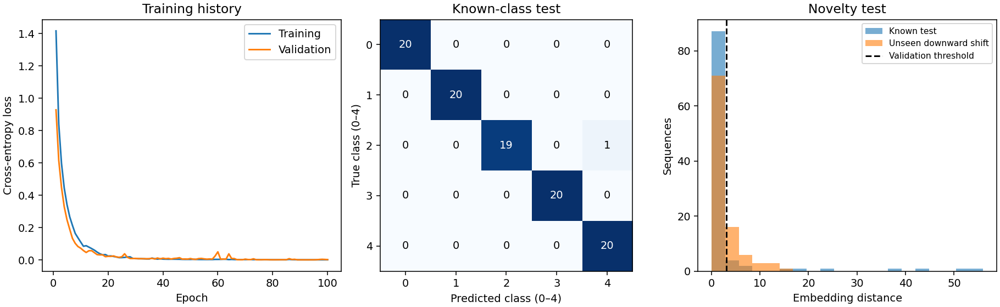

# Transformer encoder for sequence classification and novelty detection

A compact PyTorch transformer learns five control-chart pattern classes and flags unfamiliar sequences using distances in its learned representation. Includes public data, training, held-out evaluation, a saved model, predictions, plots and unit tests.

## Run

Use Python 3.10 or later with the pinned dependencies.

```sh
python -m pip install -r requirements.txt
python -m unittest -v
python train.py
python predict.py data/synthetic_control.data --checkpoint benchmark/model.pt
```

Training writes `results/model.pt`, `metrics.json`, `history.csv`, `predictions.csv` and `evaluation.png`. The included `benchmark/` is an actual seed-7 run. Prediction accepts whitespace-delimited rows of exactly 60 measurements and returns a known-class prediction, novelty score and flag. The flag can override interpretation of the known-class prediction for unfamiliar inputs.

## Model

Each 60-sample sequence becomes ten nonoverlapping patches of six values. A linear layer maps each patch to 32 features. Learned positional embeddings preserve sequence order. Two transformer encoder layers each use four attention heads, a 64-feature feed-forward block, GELU activations and 0.1 dropout. Mean pooling creates a 32-feature sequence representation and a linear head produces five class logits.

Self-attention lets each patch combine information from the other patches. Residual connections preserve earlier information while layer normalization stabilizes the intermediate representations. Cross-entropy trains the class head and encoder together. AdamW updates the weights with gradient clipping. Encoder layers receive independent matrix initialization.

This is an offline whole-sequence model. Its attention is bidirectional and all 60 observations are available before prediction. It has no causal streaming guarantee.

## Evaluation protocol

The public UCI Synthetic Control Chart dataset has six simulated pattern classes. The five known classes are normal, cyclic, increasing trend, decreasing trend and upward shift. The sixth class, downward shift, is excluded from training, validation, normalization and threshold calibration.

For each known class, seed 7 selects 60 training, 20 validation and 20 test examples. The model therefore trains on 300 sequences, selects its checkpoint using validation cross-entropy on 100 sequences, and reports known-class results on 100 test sequences. All 100 withheld downward shifts form the novelty test. Exact row indices are saved.

A scalar mean and standard deviation are estimated only from training values. The run uses 100 epochs, learning rate 0.001, weight decay 0.01 and batches of 32. The best validation-loss checkpoint is evaluated on test data after training. Classification reports accuracy, macro F1 and a confusion matrix. A raw-sequence nearest-centroid classifier supplies a baseline using the same split.

Novelty detection computes each training class's mean embedding and a pooled diagonal within-class variance, floored at 0.01. A sequence's novelty score is its minimum standardized squared distance to the five centers, averaged over embedding dimensions. A threshold is set to the 95th percentile of known validation scores. The test reports false positives among known sequences, recall on the withheld class, and AUROC with unknown examples as positives. The nominal 5% validation tail does not guarantee a 5% false-positive rate on future data.

This experiment tests one kind of held-out pattern on a small public simulated dataset. Downward shifts resemble decreasing trends, so novelty detection may be difficult. It does not establish detection of arbitrary unknowns or identify crystalline phases in real XRD.



## Measured seed-7 results

| Measure | Result |
|---|---:|
| Known-class test accuracy | 99/100 (99%) |
| Macro F1 | 0.9900 |
| Nearest-centroid baseline accuracy | 87% |
| Novelty AUROC | 0.6908 |
| Withheld downward-shift recall | 28% |
| Known-test false-positive rate | 12% |
| Trainable parameters | 17,797 |
| Training time, 100 epochs | 5.05 seconds |

These are one fixed split and one training seed on CPU with Python 3.10.6 and PyTorch 2.14.1. The selected checkpoint is epoch 92. The novelty detector misses 72 of the 100 unfamiliar examples at the validation-selected threshold. The classifier's strong known-class score therefore does not imply reliable novelty rejection. Full split indices, timing scope, predictions and learning curves are included in `benchmark/`. Inference timing is a single batch measurement and excludes checkpoint loading.

## Understand the code

- `model.py` contains the actual transformer encoder and embedding-distance calculation.
- `train.py` creates disjoint splits, trains, selects the checkpoint and evaluates.
- `predict.py` loads the checkpoint with its preprocessing and novelty reference.
- `test_model.py` checks gradient flow, distinct layer initialization, split isolation, scoring, invalid inputs and checkpoint round trips.

The model could be adapted to histories of diffraction-peak features, but that requires suitable sequences and labels. The XRD and sensor projects remain separate applications.

[Dataset provenance](data/README.md) · [PyTorch transformer encoder](https://docs.pytorch.org/docs/stable/generated/torch.nn.TransformerEncoder.html)
